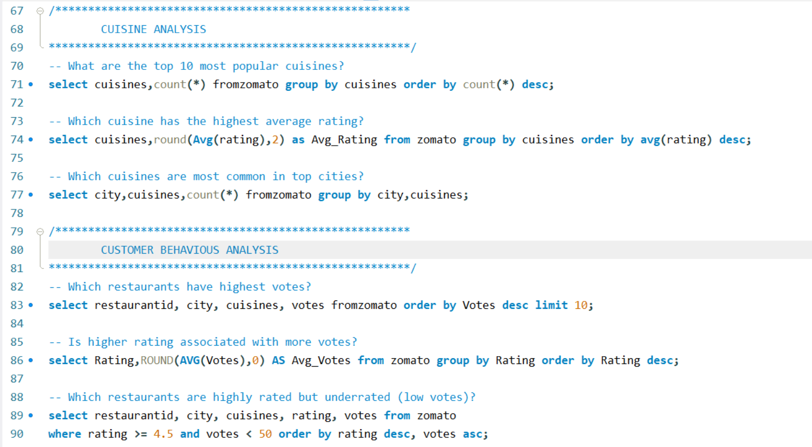
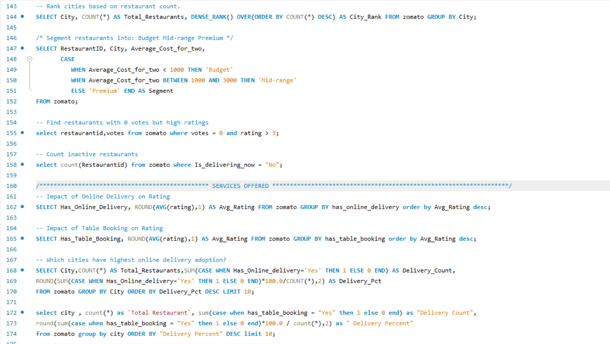
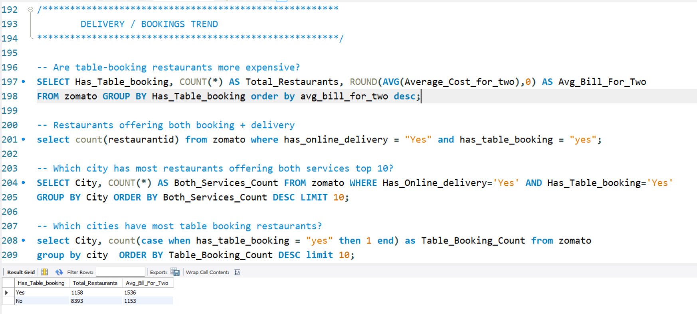
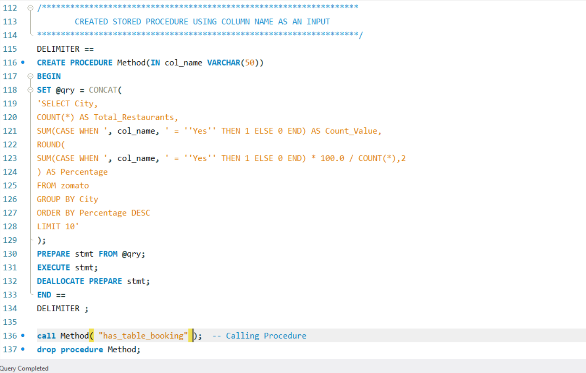

<div align="center">

# 🍽️ Zomato Sales & Rating Analysis

### Advanced SQL + 3-Page Interactive Tableau Dashboard


<br>


<br>

> *An in-depth analysis of Zomato's global restaurant data covering **9,551 restaurants** across **15 countries** and **141 cities** — using advanced SQL queries and a 3-page interactive Tableau dashboard with Key Business Insights on every page.*

</div>

---

## 📑 Table of Contents

- [📌 Project Overview](#-project-overview)
- [🛠️ Tools Used](#️-tools-used)
- [📊 Tableau Dashboard — 3 Pages](#-tableau-dashboard--3-pages)
- [🗄️ SQL — Query Screenshots](#️-sql--query-screenshots)
- [💡 Key Business Insights](#-key-business-insights)
- [📂 Project Structure](#-project-structure)
- [🗃️ Dataset](#️-dataset)
- [🔗 Live Dashboard](#-live-dashboard)
- [👤 Author](#-author)

---

## 📌 Project Overview

This project analyzes Zomato's restaurant dataset to uncover insights about **restaurant performance, customer preferences, cuisine trends, pricing patterns, and delivery/booking behavior** across global markets.

### 🎯 Key Business Questions Answered

| # | Question |
|---|----------|
| 1️⃣ | Which **countries and cities** dominate Zomato's restaurant presence? |
| 2️⃣ | How do **online delivery and table booking** affect customer ratings? |
| 3️⃣ | What **cuisines** are most popular and most engaging for customers? |
| 4️⃣ | Which **price ranges** have the most restaurants and best ratings? |
| 5️⃣ | What is the relationship between **votes, ratings, and restaurant quality**? |

---

## 🛠️ Tools Used

| Tool | Purpose |
|------|---------|
|  | 25+ advanced queries — KPI views, stored procedures, window functions, segmentation |
|  | 3-page interactive Tableau dashboard published on Tableau Public |

---

## 📊 Tableau Dashboard — 3 Pages

### 🏠 Page 1 — Executive Overview


### 😊 Page 2 — Customer Experience Analysis


### 🍜 Page 3 — Cuisine & Pricing Analysis


---

## 🗄️ SQL — Query Screenshots

| Query Set | Preview |
|-----------|---------|
| 📌 KPI View — 9 metrics in one query |  |
| 🏙️ City Analysis + Revenue Analysis |  |
| 🍛 Cuisine + Customer Behaviour Analysis |  |
| 🛎️ Services Offered + Window Functions |  |
| 🚚 Delivery & Booking Trend Analysis |  |
| ⚙️ Advanced Stored Procedure |  |

---

## 💡 Key Business Insights

### 🍴 Restaurant Overview *(from KPI View)*

| Metric | Value |
|:-------|------:|
| 🏪 **Total Restaurants** | **9,551** |
| 🌍 Countries | 15 |
| 🏙️ Cities | 141 |
| 🍲 Total Cuisines (unique types) | 1,825 |
| ⭐ Average Rating | 2.9 / 5 |
| 💸 Avg Cost for Two | ₹1,199 |
| 🗳️ Total Votes | 14,98,645 |
| 🚚 Online Delivery | 25.66% (2,451 restaurants) |
| 📅 Table Booking | 12.12% (1,158 restaurants) |

---

### 🌍 Country Insights *(Page 1)*

- 🇮🇳 **India dominates** with **8,652 restaurants** and **11,87,163 votes** — far ahead of all countries
- 🇺🇸 **USA** is second with 434 restaurants and 1,85,848 votes
- 🇮🇩 **Indonesia** has highest avg cost for two (2,81,190 local currency)
- ⭐ Most countries maintain avg rating of **4** — consistent quality

**🏆 Top 5 by Votes**

| Rank | Country | Votes |
|:----:|:--------|------:|
| 1 | India | 11,87,163 |
| 2 | USA | 1,85,848 |
| 3 | UAE | 29,611 |
| 4 | SA | 18,910 |
| 5 | UK | 16,439 |

---

### 😊 Customer Experience Insights *(Page 2)*

| Factor | With | Without |
|:-------|:----:|:-------:|
| 📅 **Table Booking** (avg rating) | **3.5** | 2.8 |
| 🚚 **Online Delivery** (avg rating) | **3.3** | 2.8 |

- 📅 Table booking = **quality signal**
- 🚀 Only **25.66%** restaurants have online delivery — **significant expansion opportunity**
- 📊 Most restaurants concentrated between **rating 3.0–4.0** — moderate customer satisfaction
- 🥇 **2,490 restaurants** fall in 3.0–3.5 rating band — largest group
- 🔥 **North Indian Mughlai** is most engaging cuisine with **53,747 votes**
- 🗳️ **Avg votes per restaurant: 157** &nbsp;|&nbsp; ⭐ **High rated restaurants: 1,380**

---

### 🍜 Cuisine & Pricing Insights *(Page 3)*

- 🍛 **North Indian** is the most common cuisine — **936 restaurants**
- 💰 **Cheap price range** (₹1) has the most restaurants: **4,444**
- 👑 **Luxury restaurants** (₹4) have the highest avg rating: **3.84**
- 📈 Higher price = better rating — clear positive correlation
- ☕ **North Indian Mughlai** and **Cafe** cuisines have highest customer ratings (3.0)
- 🧾 **Cheap + Affordable** price ranges account for majority of all listings

---

## 📂 Project Structure

```
04_Zomato-Sales-Rating-Analysis/
│
├── README.md                          ← You are here
│
├── raw-data/
│   └── README.md
│
├── sql/
│   ├── Zomato_Analysis.sql            ← All 25+ SQL queries
│   └── README.md
│
├── tableau/
│   ├── tableau_link.txt               ← Live Tableau Public link
│   └── README.md
│
└── Screenshots/
    ├── Z_1.png                        ← Tableau Page 1 — Executive Overview
    ├── Z_2.png                        ← Tableau Page 2 — Customer Experience
    ├── Z_3.png                        ← Tableau Page 3 — Cuisine & Pricing
    ├── Z1.png                         ← SQL: Stored Procedure
    ├── Z2.png                         ← SQL: KPI View + output
    ├── Z3.png                         ← SQL: Delivery & Booking Trend
    ├── Z4.png                         ← SQL: Cuisine + Customer Behaviour
    ├── Z5.png                         ← SQL: City + Revenue Analysis
    └── Z6.png                         ← SQL: Window Functions + Services
```

---

## 🗃️ Dataset

| Field | Details |
|:------|:--------|
| **Source** | Zomato Restaurant Dataset (publicly available) |
| **Table** | `zomato` (MySQL) |
| **Total Records** | 9,551 restaurants |
| **Coverage** | 15 countries, 141 cities |
| **Key Fields** | RestaurantID, City, Cuisines, Rating, Votes, Average_Cost_for_two, Has_Online_Delivery, Has_Table_Booking, Price_range, CountryCode, Is_delivering_now |

---

## 🔗 Live Dashboard

| Platform | Link |
|----------|------|
| 📊 Tableau Public | [View Live Zomato 3-Page Dashboard](yaha link) |

---

## 👤 Author

<div align="center">

### **Dishant Bhere**

**Data Analyst**


⭐ *If you found this useful, consider giving the repo a star!*

</div>
