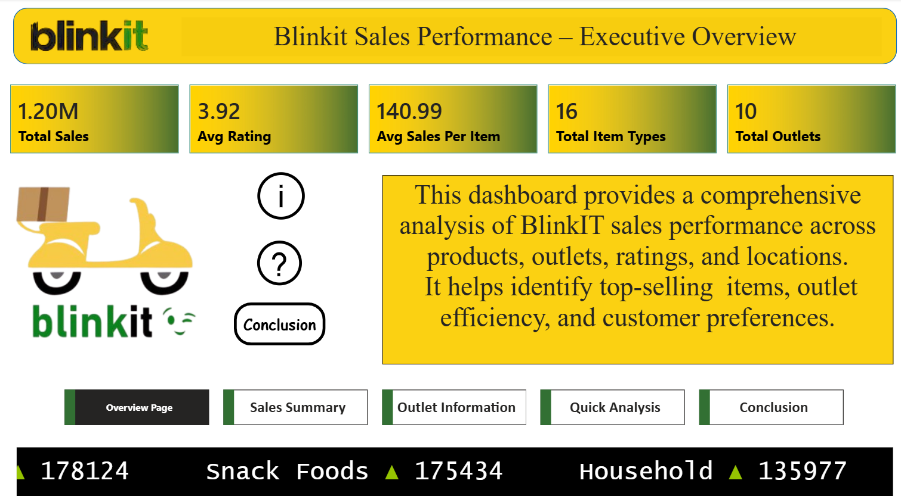
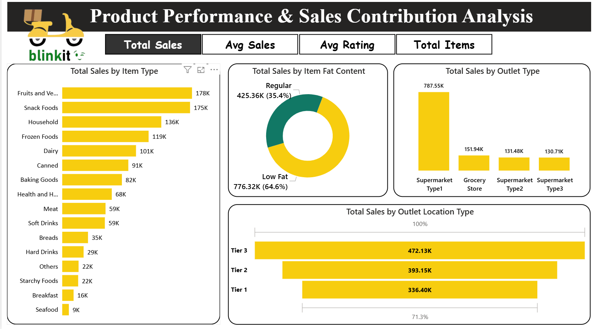
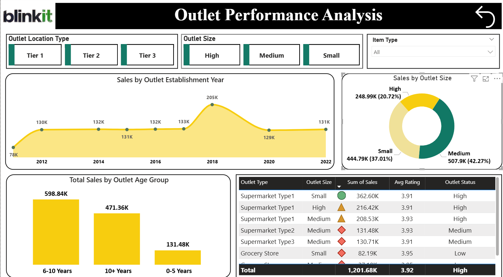
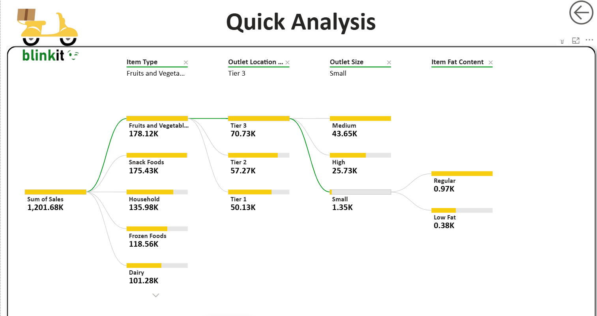
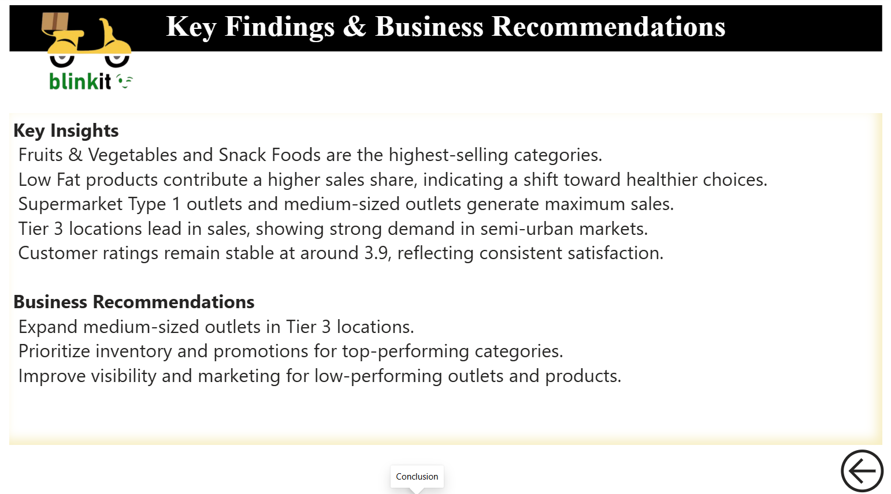

<div align="center">

# 🛒 Blinkit Sales Performance Dashboard

### Executive-Level 5-Page Power BI Dashboard · Excel Data Prep


<br>



<br>

> *A comprehensive 5-page Power BI dashboard analyzing Blinkit's sales performance across products, outlets, locations, and customer preferences — with Excel used for data cleaning and preparation.*

</div>

---

## 📑 Table of Contents

- [📌 Project Overview](#-project-overview)
- [🛠️ Tools Used](#️-tools-used)
- [🖼️ Dashboard Pages](#️-dashboard-pages)
- [💡 Key Business Insights](#-key-business-insights)
- [📂 Project Structure](#-project-structure)
- [🗃️ Dataset](#️-dataset)
- [👤 Author](#-author)

---

## 📌 Project Overview

This project analyzes **BlinkIT grocery delivery sales data** to uncover performance trends across product categories, outlet types, tier locations, and outlet sizes. The dashboard is designed as an **executive-level report** with 5 interactive pages covering everything from a high-level overview to a granular decomposition tree.

### 🎯 Key Business Questions Answered

| # | Question |
|---|----------|
| 1️⃣ | Which **product categories and item types** drive the most sales? |
| 2️⃣ | How do **outlet type, size, and location tier** affect performance? |
| 3️⃣ | What is the impact of **fat content** (Low Fat vs Regular) on sales? |
| 4️⃣ | Which outlets are **highest performing** and which need improvement? |
| 5️⃣ | What are the key **business recommendations** based on the data? |

---

## 🛠️ Tools Used

| Tool | Purpose |
|------|---------|
|  | Data cleaning, formatting, handling missing values, data preparation before loading into Power BI |
|  | 5-page interactive dashboard — Overview, Sales Summary, Outlet Performance, Quick Analysis, Conclusion |

---

## 🖼️ Dashboard Pages

| Page | Preview |
|------|---------|
| 🏠 **Overview / Executive Summary** |  |
| 🥦 **Product Performance & Sales Contribution** |  |
| 🏬 **Outlet Performance Analysis** |  |
| 🌳 **Quick Analysis (Decomposition Tree)** |  |
| 🎯 **Key Findings & Business Recommendations** |  |

---

## 💡 Key Business Insights

### 📊 Overall KPIs

| Metric | Value |
|:-------|------:|
| 💵 **Total Sales** | **$1.20M** |
| ⭐ **Average Rating** | **3.92** |
| 🛍️ Average Sales Per Item | $140.99 |
| 🏬 Total Outlets | 10 |
| 🏷️ Total Item Types | 16 |

- 😊 Rating **3.92** — consistently high customer satisfaction

---

### 🥦 Product Performance

| Rank | Category | Sales |
|:----:|:---------|------:|
| 🥇 1 | Fruits & Vegetables | 178K |
| 🥈 2 | Snack Foods | 175K |
| 🥉 3 | Household | 136K |

- 🥛 **Low Fat products** dominate at **64.6% (776.32K)** vs Regular at **35.4% (425.36K)** — strong consumer shift toward healthy options
- 📉 Bottom categories: Seafood (9K), Breakfast (16K), Starchy Foods (22K)

---

### 🏬 Outlet Performance

**By Outlet Type & Size**

- 🏆 **Supermarket Type 1** is the top outlet type at **787.55K** — 3× higher than any other outlet type

| Outlet Size | Sales | Share |
|:------------|------:|------:|
| 🥇 Medium | 507.9K | 42.27% |
| 🥈 Small | 444.79K | 37.01% |
| 🥉 High | 248.99K | 20.72% |

**By Location Tier**

| Tier | Sales |
|:-----|------:|
| 🥇 Tier 3 | 472.13K |
| 🥈 Tier 2 | 393.15K |
| 🥉 Tier 1 | 336.40K |

- 🌆 Tier 3 leads — strong semi-urban market demand

**By Outlet Age**

- 📅 **Outlets established in 2018** had the highest sales at **205K**; recent outlets (2022) at **131K**
- 📈 **6–10 year old outlets (598.84K)** outperform 10+ year (471.36K) and 0–5 year (131.48K) outlets

---

### 🌳 Quick Analysis — Decomposition Tree

- 🔽 Total Sales of **1,201.68K** broken down by: Item Type → Outlet Location Tier → Outlet Size → Fat Content
- 🏅 Top path: Fruits & Vegetables (178.12K) → Tier 3 (70.73K) → Medium size (43.65K)

---

### 🎯 Key Findings & Business Recommendations

**🔎 Findings**

- 🥦 Fruits & Vegetables and Snack Foods are the highest-selling categories
- 🥛 Low Fat products contribute a higher sales share — indicating shift toward healthier choices
- 🏬 Supermarket Type 1 outlets and medium-sized outlets generate maximum sales
- 🌆 Tier 3 locations lead in sales — showing strong demand in semi-urban markets
- ⭐ Customer ratings remain stable at ~3.9 — consistent satisfaction

**🚀 Recommendations**

- ✅ Expand medium-sized outlets in Tier 3 locations
- ✅ Prioritize inventory and promotions for top-performing categories
- ✅ Improve visibility and marketing for low-performing outlets and products

---

## 📂 Project Structure

```
05_Blinkit-Sales-Dashboard/
│
├── README.md                          ← You are here
│
├── raw-data/
│   └── README.md                      ← Dataset description
│
├── excel/
│   ├── Blinkit Grocery Data.xlsx      ← Excel cleaned dataset
│   └── README.md
│
├── powerbi/
│   ├── Blinkit_Dashboard.pbix         ← Power BI 5-page dashboard
│   └── README.md
│
└── Screenshots/
    ├── B1.png                         ← Overview / Executive Summary
    ├── B2.png                         ← Product Performance & Sales
    ├── B3.png                         ← Outlet Performance Analysis
    ├── B4.png                         ← Quick Analysis (Decomposition Tree)
    └── B5.png                         ← Key Findings & Recommendations
```

---

## 🗃️ Dataset

| Field | Details |
|:------|:--------|
| **Source** | BlinkIT Grocery Sales Dataset |
| **Cleaned using** | Microsoft Excel (removed nulls, standardized categories, formatted columns) |
| **Total Records** | Sales data across 10 outlets, 16 item types |
| **Key Fields** | Item Type, Item Fat Content, Outlet Type, Outlet Size, Outlet Location Type, Outlet Establishment Year, Sales, Rating |

---

## 👤 Author

<div align="center">

### **Dishant Bhere**

**Data Analyst**


⭐ *If you found this useful, consider giving the repo a star!*

</div>
