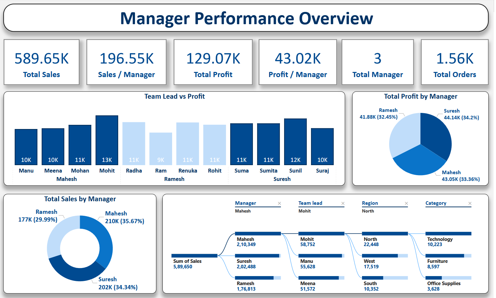
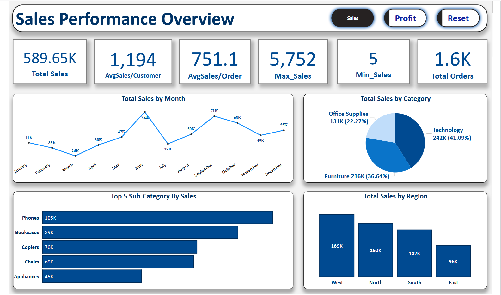
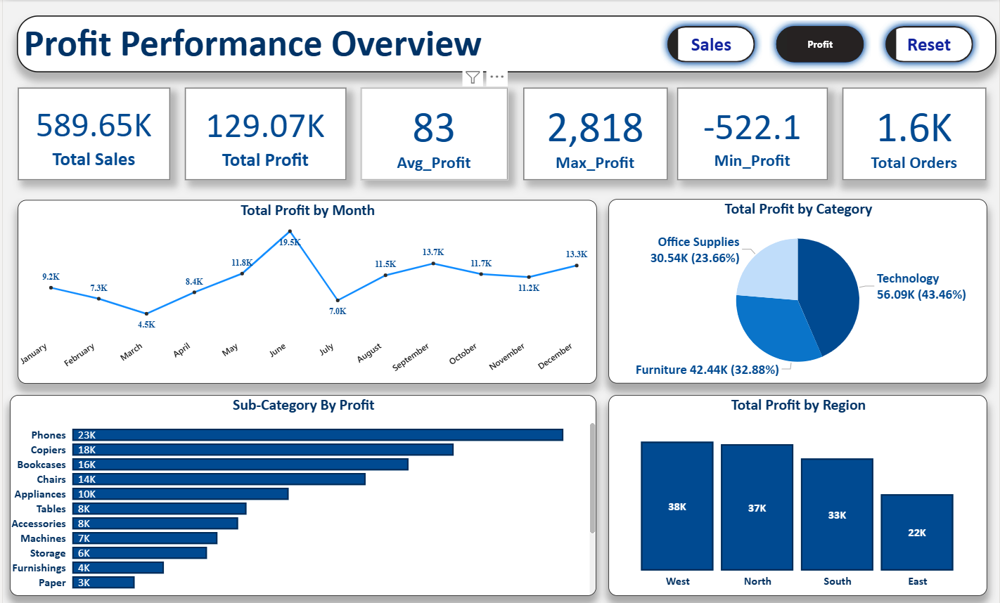
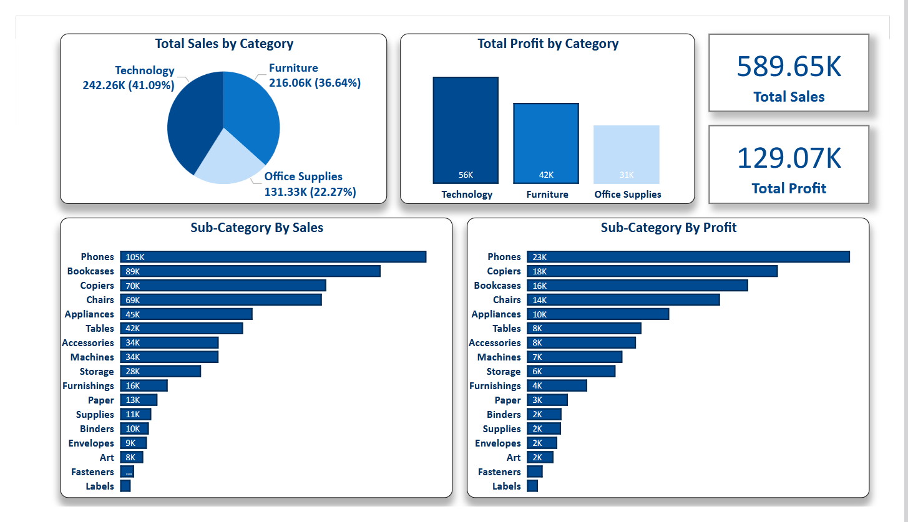
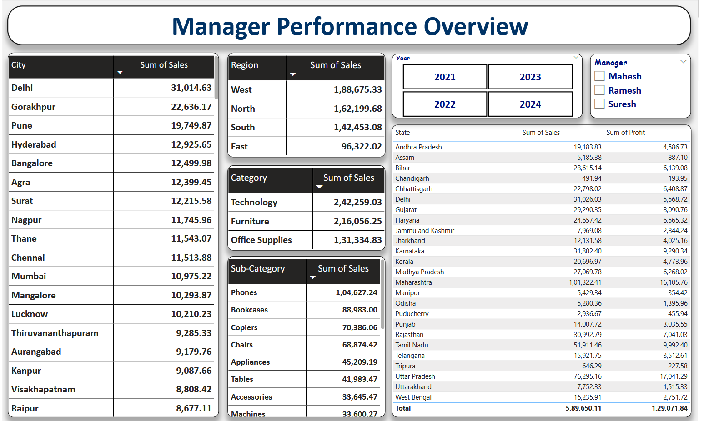

<div align="center">

# 🇮🇳 India Sales Dashboard

### Interactive 5-Page Power BI Dashboard · Sales · Profit · Manager Performance


<br>



<br>

> *A comprehensive dashboard analyzing India sales performance across managers, regions, categories, sub-categories, cities, and states — with interactive filters, toggle buttons, and a decomposition tree.*

</div>

---

## 📑 Table of Contents

- [📌 Project Overview](#-project-overview)
- [🛠️ Tools Used](#️-tools-used)
- [🖼️ Dashboard Pages](#️-dashboard-pages)
- [💡 Key Business Insights](#-key-business-insights)
- [📂 Project Structure](#-project-structure)
- [🗃️ Dataset](#️-dataset)
- [👤 Author](#-author)

---

## 📌 Project Overview

This project analyzes a **fictional Indian sales dataset** covering managers, team leads, regions, categories, and sub-categories. The dashboard spans **5 dedicated pages**, each giving a different analytical view — from high-level KPIs down to state-wise and sub-category-level breakdowns.

### 🎯 Key Questions Answered

| # | Question |
|---|----------|
| 1️⃣ | Which managers and team leads drive the most **sales and profit**? |
| 2️⃣ | Which **product categories and sub-categories** perform best? |
| 3️⃣ | How do sales and profit **trend month by month**? |
| 4️⃣ | Which **regions and states** generate maximum revenue? |
| 5️⃣ | How do sub-categories compare on **both sales and profit**? |

---

## 🛠️ Tools Used

| Tool | Purpose |
|:----:|---------|
|  | 5-page interactive dashboard with toggle buttons, decomposition tree, slicers |

---

## 🖼️ Dashboard Pages

| Page | Preview |
|------|---------|
| 👔 Manager Performance Overview |  |
| 💰 Sales Performance Overview |  |
| 📈 Profit Performance Overview |  |
| 🗂️ Category Analysis |  |
| 📋 Data Table |  |

---

## 💡 Key Business Insights

### 📊 Overall KPIs

| Metric | Value |
|:-------|------:|
| 💵 **Total Sales** | **589.65K** |
| 💹 **Total Profit** | **129.07K** |
| 🧾 **Total Orders** | **1,600** |
| 👥 **Total Managers** | **3** |
| 🙋 Avg Sales per Customer | 1,194 |
| 🛒 Avg Sales per Order | 751.1 |
| 🔝 Max Sales (single order) | 5,752 |
| 📊 Avg Profit | 83 |
| ⬆️ Max Profit | 2,818 |
| ⬇️ Min Profit | -522.1 |

---

### 👔 Manager Performance

| Manager | Total Sales | Sales % | Total Profit | Profit % |
|:--------|-----------:|--------:|-------------:|---------:|
| 🥇 Mahesh | 210K | 35.67% | 43.05K | 33.36% |
| 🥈 Suresh | 202K | 34.34% | 44.14K | 34.20% |
| 🥉 Ramesh | 177K | 29.99% | 41.88K | 32.45% |

- 🏆 **Mahesh** leads in total sales (210K), but **Suresh** leads in profit (44.14K)
- ⚖️ **Sales per Manager:** 196.55K &nbsp;|&nbsp; **Profit per Manager:** 43.02K
- 🌳 **Decomposition tree:** Sales (589,650) → Mahesh (210,349) → Mohit (team lead) → North region (22,448) → Technology (10,223)

---

### 🗂️ Category Performance

| Category | Sales | Sales % | Profit |
|:---------|------:|--------:|-------:|
| 💻 Technology | 242K | 41.09% | 56K |
| 🪑 Furniture | 216K | 36.64% | 42K |
| 📎 Office Supplies | 131K | 22.27% | 31K |

- 💻 **Technology** leads in both sales (41.09%) and profit (56K)
- 📱 **Phones** is the top sub-category by sales (105K) and profit (23K)
- 🖨️ **Copiers** rank 2nd in profit (18K), 📚 **Bookcases** 3rd (16K)

---

### 🌍 Regional Performance

| Region | Sales | Profit |
|:-------|------:|-------:|
| 🧭 West | 189K | 38K |
| 🧭 North | 162K | 37K |
| 🧭 South | 142K | 33K |
| 🧭 East | 96K | 22K |

- ✅ **West** leads in both sales and profit
- ⚠️ **East** is the weakest performing region

---

### 📅 Monthly Trends

| Signal | Month | Value |
|:-------|:-----:|------:|
| 📈 Sales peak | **June** | 75K |
| 📉 Sales low | **March** | 26K |
| 📈 Profit peak | **June** | 19.5K |
| 📉 Profit low | **March** | 4.5K |

- 🔻 **July** shows a sharp dip in both sales (39K) and profit (7K) before recovery
- 🔗 Profit trend follows the sales trend consistently

---

### 🏙️ City & State Performance

- 🏙️ **Delhi** is the top city by sales: **31,014.63**
- 🥇 **Maharashtra** — top state: **1,01,322.41** in sales, **16,105.76** in profit
- 🥈 **Uttar Pradesh** — 2nd: **76,295.16** sales, **17,041.29** profit
- 🎛️ Data available for years **2021, 2022, 2023, 2024** with Manager filter (Mahesh / Ramesh / Suresh)

---

### 🏅 Top 5 Sub-Categories by Sales

| Rank | Sub-Category | Sales |
|:----:|:-------------|------:|
| 1 | 📱 Phones | 105K |
| 2 | 📚 Bookcases | 89K |
| 3 | 🖨️ Copiers | 70K |
| 4 | 🪑 Chairs | 69K |
| 5 | 🔌 Appliances | 45K |

---

## 📂 Project Structure

```
10_India-Sales-Dashboard/
│
├── README.md                        ← You are here
│
├── raw-data/
│   └── README.md
│
├── powerbi/
│   ├── India_Sales_Dashboard.pbix   ← Power BI 5-page dashboard
│   └── README.md
│
└── Screenshots/
    ├── I1.png                       ← Manager Performance Overview
    ├── I2.png                       ← Profit Performance Overview
    ├── I3.png                       ← Data Table page
    ├── I4.png                       ← Sales Performance Overview
    └── I5.png                       ← Category Analysis
```

---

## 🗃️ Dataset

| Field | Details |
|:------|:--------|
| **Source** | India Sales Dataset (Sales / Profit / Manager / Region data) |
| **Coverage** | India — multiple cities and states |
| **Years** | 2021, 2022, 2023, 2024 |
| **Key Fields** | Manager, Team Lead, Region, State, City, Category, Sub-Category, Sales, Profit, Orders |

---

## 👤 Author

<div align="center">

### **Dishant Bhere**

**Data Analyst**


⭐ *If you found this useful, consider giving the repo a star!*

</div>
