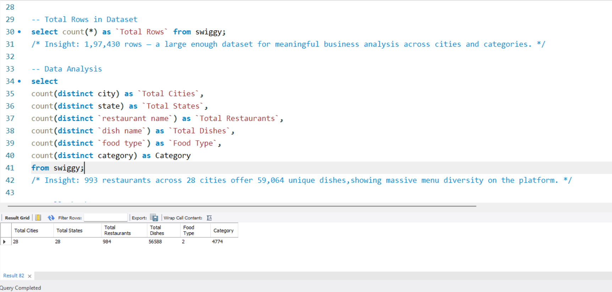

# 🍽️ Swiggy Food Orders Analysis

<p align="center">
  
</p>

<p align="center">
  <strong>Turning 197K+ food orders into actionable business insights using MySQL.</strong>
</p>

<p align="center">
  
  
  
</p>

<p align="center">
  
  
  
  
</p>

---

## 📌 Project Overview

**Swiggy Food Orders Analysis** is an end-to-end SQL analytics project that explores **197,430 food order records** across 993 restaurants, 28 cities, and 59,064 unique dishes.

Using **MySQL**, this project investigates restaurant performance, dish pricing, food preferences, city-wise demand, time-based ordering trends, and customer ratings to uncover meaningful business insights.

The analysis combines exploratory data analysis (EDA), aggregations, filtering, subqueries, window functions, string manipulation, views, and stored procedures to demonstrate practical SQL skills in a real-world business context.

### 🎯 Business Questions Answered

- 🌍 Which cities and states generate the highest number of orders?
- 🥗 How do Veg and Non-Veg dishes compare in availability and pricing?
- 📅 Which days, weeks, and months experience the highest ordering activity?
- ⭐ Which cities and dishes have the strongest ratings?
- 💰 How are dishes distributed across Budget, Mid-Range, Premium, and Luxury categories?
- 🏪 Which restaurants offer extensive menus and competitive pricing?
- 🔎 What data quality issues can be identified before analysis?

---

## 🛠️ Tools & Technologies

| Tool / Technology | Purpose |
|:---|:---|
| **MySQL** | Querying, data analysis, aggregation, and business reporting |
| **MySQL Workbench** | SQL development and query execution |
| **SQL Window Functions** | Calculating percentages and analyzing distributions |
| **SQL Views** | Creating reusable analytical datasets |
| **Stored Procedures** | Generating parameterized reports |
| **CASE WHEN** | Categorizing prices and classifying business segments |
| **Subqueries** | Comparing individual records against aggregate benchmarks |
| **String Functions & REGEXP** | Text transformation and pattern matching |

---

## 📸 SQL Analysis & Screenshots

The following screenshots demonstrate the SQL queries, analytical techniques, and results produced during the project.

| Screenshot | Analysis | Key Takeaway |
|:---|:---|:---|
| [SW1.png](Screenshots/SW1.png) | Dataset Scale Analysis | 28 cities, 993 restaurants, and 59,064 unique dishes |
| [SW2.png](Screenshots/SW2.png) | Data Quality Validation | Zero missing values across all 14 columns |
| [SW3.png](Screenshots/SW3.png) | Food Type Distribution | Veg dishes account for approximately 71.5% of records |
| [SW4.png](Screenshots/SW4.png) | HAVING Clause Analysis | Panaji and Lucknow are the only cities with average dish prices above ₹300 |
| [SW5.png](Screenshots/SW5.png) | Weekday vs. Weekend Analysis | 70.92% of orders fall on weekdays |
| [SW6.png](Screenshots/SW6.png) | Price Category Segmentation | Mid-Range dishes represent 58.51% of the dataset |
| [SW7.png](Screenshots/SW7.png) | SQL Views | Creation and execution of reusable analytical views |
| [SW8.png](Screenshots/SW8.png) | Stored Procedures | Parameterized procedures for dish rankings and city reports |

---

## 📊 Key Business Insights

### 1. Dataset Overview

The dataset provides a broad view of Swiggy's restaurant and food listing landscape.

| Metric | Value |
|:---|---:|
| Total Records | 197,430 |
| Total Cities | 28 |
| Total Restaurants | 993 |
| Total Unique Dishes | 59,064 |
| Total Columns | 14 |
| Missing Values | 0 |

**Key takeaway:** All 14 columns passed the missing-value validation performed during the analysis, providing a clean starting point for further exploration.

### 2. 💰 Pricing Analysis

| Metric | Finding |
|:---|:---|
| Average Dish Price | ₹268.51 |
| Minimum Dish Price | ₹0.95 |
| Maximum Dish Price | ₹8,000 |
| Dishes Above Average Price | 77,848 (approximately 39.4%) |
| Highest-Priced City Average | Panaji — approximately ₹306 |
| Second-Highest City Average | Lucknow — approximately ₹305 |

**Key findings:**

- The average listed dish price is approximately **₹268.51**.
- Around **39.4% of dishes** are priced above the platform-wide average.
- Panaji and Lucknow are the only cities with average dish prices above ₹300 in this analysis.
- Mumbai and Delhi have average dish prices below ₹300.
- Non-Veg dishes are more expensive on average than Veg dishes.

**Business implication:** The distribution suggests a strong mid-priced offering, while higher-priced dishes provide a premium segment within the platform.

### 3. 🏷️ Price Category Distribution

Dishes were classified into four pricing segments using the SQL `CASE WHEN` expression.

| Price Category | Price Range | Percentage |
|:---|:---|---:|
| 🟢 Budget | Below ₹150 | 27.45% |
| 🔵 Mid-Range | ₹150–₹400 | 58.51% |
| 🟠 Premium | ₹400–₹800 | 11.86% |
| 🔴 Luxury | Above ₹800 | 2.18% |

**Key takeaway:** The **Mid-Range category dominates with 58.51%** of all dish records, indicating that most listed dishes fall within the ₹150–₹400 price bracket.

### 4. 🥗 Food Type Distribution

| Food Type | Records | Percentage |
|:---|---:|---:|
| Veg | 140,604 | 71.5% |
| Non-Veg | 56,826 | 28.5% |
| **Total** | **197,430** | **100%** |

### 5. 📅 Time-Based Ordering Trends

| Metric | Finding |
|:---|:---|
| Busiest Day | Saturday — 28,938 orders |
| Second-Busiest Day | Sunday — 28,474 orders |
| Slowest Day | Tuesday |
| Weekday Orders | 140,018 (70.92%) |
| Weekend Orders | 57,412 (29.08%) |
| Busiest Date | 22 February 2025 — 1,550 orders |
| Highest-Order Quarter | Q2 — 74,163 orders |
| Highest-Order Month | January — 25,398 orders |
| Highest Average-Price Quarter | Q1 — ₹269.07 |

### 6. ⭐ Ratings & Restaurant Performance

| Metric | Finding |
|:---|:---|
| Overall Average Rating | Approximately 4.0 |
| Cities Meeting the Rating and Volume Criteria | 28 out of 28 |
| Highest Average City Rating | Kochi — 4.44 |
| Other High-Rating Cities | Aizawl and Kolkata — 4.41 |

**Key findings:**

- The overall average rating is approximately 4.0.
- All 28 cities satisfy the analysis criteria of more than 1,000 orders and an average rating above 3.8.
- Kochi leads with an average rating of 4.44.
- Aizawl and Kolkata follow with average ratings of 4.41.
- Many dishes fall into the Unrated or Low (1–25) rating-count categories.

**Business implication:** City-level ratings help identify markets with strong customer feedback, while low rating counts highlight dishes for which customer feedback may be limited.

---

## 🧩 SQL Views Created

SQL views were created to simplify repeated analysis and make frequently used results easier to retrieve.

| View | Purpose |
|:---|:---|
| `vw_city_summary` | Summarizes total orders, restaurants, average dish price, and average rating by city |
| `vw_top_rated_dishes` | Retrieves dishes with ratings above 4.5 and at least 100 ratings |

### Why Views?

- ♻️ Reuse analytical logic without rewriting lengthy queries.
- 📊 Simplify city-level reporting.
- 🔍 Make high-performing dishes easier to identify.
- 🧱 Organize frequently used SQL logic into reusable database objects.

---

## ⚙️ Stored Procedures Created

Two stored procedures were developed to make common analytical tasks reusable and parameter-driven.

| Procedure | Parameters | Purpose |
|:---|:---|:---|
| `GetTopDishes(city_name, top_n)` | City name and number of dishes | Returns the top N dishes by order count for a selected city |
| `cityreport(city_name)` | City name | Generates a city-level report containing orders, restaurants, average price, and average rating |

### Why Stored Procedures?

- 🔄 Reuse queries with different input parameters.
- 📍 Generate reports for individual cities.
- 📈 Reduce repetitive SQL code.
- ⚡ Make recurring analytical queries easier to execute.

---

## 🧠 SQL Concepts Demonstrated

This project covers fundamental and advanced SQL techniques used in practical data analysis.

### Section 1 — Database Setup & Data Loading

- `CREATE DATABASE`
- `LOAD DATA INFILE`
- Character encoding configuration using `latin1`

### Section 2 — Exploratory Data Analysis (EDA)

- Total record count
- Distinct city, restaurant, and dish counts
- NULL validation across all 14 columns
- Price and rating statistics
- Food type distribution
- Date range analysis
- Quarter-wise and day-wise order analysis

### Section 3 — Filtering & Pattern Matching

**Concepts:** `WHERE`, `BETWEEN`, `IN`, `LIKE`, `<>`, `REGEXP`

**Applications:**
- Identifying premium dishes in Bengaluru
- Filtering Non-Veg dishes
- Analyzing selected metropolitan cities
- Searching for Biryani and spelling variations
- Identifying unrated premium dishes

### Section 4 — Aggregation & HAVING

**Concepts:** `GROUP BY`, aggregate functions, `HAVING`

**Applications:**
- City-wise and state-wise aggregations
- Food type comparisons
- Identifying cities with average dish prices above ₹300
- Finding groups with more than 50 dishes
- Comparing Veg and Non-Veg dish counts

### Section 5 — Date & Time Analysis

**Functions:** `YEAR()`, `MONTH()`, `MONTHNAME()`, `DAY()`, `DAYNAME()`, `WEEKOFYEAR()`, `DATEDIFF()`

**Applications:**
- Monthly order trends
- Weekly order distribution
- Quarter-wise comparisons
- Identifying the busiest date
- Comparing weekday and weekend activity

### Section 6 — Advanced SQL

| Concept | Application |
|:---|:---|
| `CASE WHEN` | Price categories, restaurant performance labels, and day-type classification |
| Window Functions | Calculating percentages using `SUM(COUNT(*)) OVER()` |
| Subqueries | Comparing dish prices against the overall average |
| `REGEXP` | Detecting Biryani spelling variations |
| String Functions | Text transformation using `UPPER()`, `LENGTH()`, `LEFT()`, `TRIM()`, and `REPLACE()` |
| `CONCAT()` | Combining segments into labels such as `Weekend \| Veg` |

### Section 7 — Views

- `vw_city_summary` — reusable city-level aggregation.
- `vw_top_rated_dishes` — curated selection of highly rated dishes.

### Section 8 — Stored Procedures

- `GetTopDishes(city_name, top_n)` — parameterized top-dish analysis.
- `cityreport(city_name)` — city-level KPI reporting.

---

## 📁 Project Structure

```text
09_Swiggy-Analysis/
│
├── README.md                    ← Project documentation
│
├── data/
│   ├── Swiggy.csv               ← Raw Swiggy dataset
│   └── README.md
│
├── sql/
│   ├── Swiggy_Analysis.sql      ← Complete SQL analysis
│   └── README.md
│
└── Screenshots/
    ├── SW1.png                  ← Dataset scale output
    ├── SW2.png                  ← NULL check results
    ├── SW3.png                  ← Food type window function
    ├── SW4.png                  ← HAVING clause analysis
    ├── SW5.png                  ← Weekday vs. weekend analysis
    ├── SW6.png                  ← Price category segmentation
    ├── SW7.png                  ← SQL views and output
    └── SW8.png                  ← Stored procedures and output
```

---

## 📂 Dataset Information

| Property | Details |
|:---|:---|
| Dataset | Swiggy Food Orders Dataset |
| Database Table | `swiggy` |
| Database System | MySQL |
| Total Records | 197,430 |
| Total Columns | 14 |
| Key Fields | Restaurant name, dish name, city, state, food type, category, price, rating, rating count, order date, week number, quarter, day, and location |

The dataset was used to analyze food listings, pricing patterns, geographic distribution, ratings, and order trends.

---


## 👨‍💻 Author

**Dishant Bhere**

*Aspiring Data Analyst*

**Technical Skills:** SQL · Power BI · Tableau · Excel · Python

---

